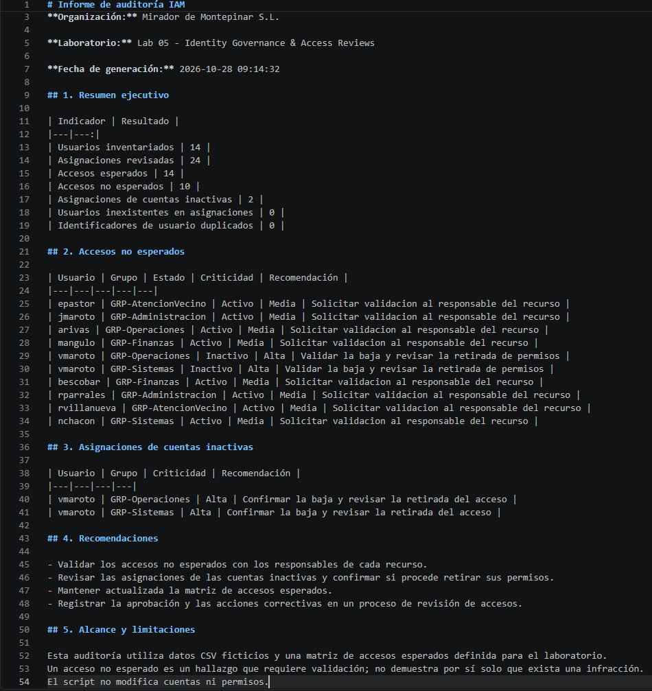
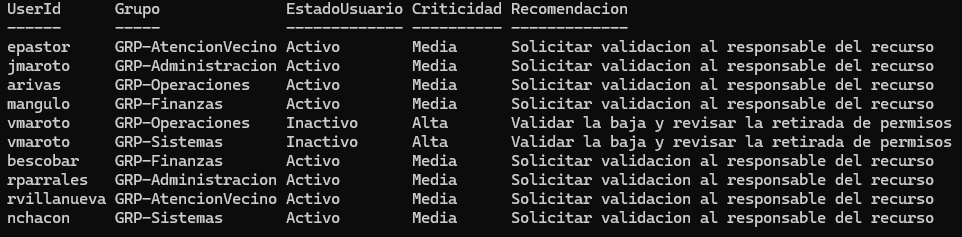
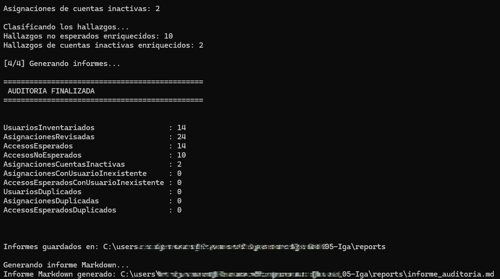

# 05_Gobernanza de Identidad y Revisión de Acceso: Mirador de Montepinar S.L. · Operación «Control de Accesos»


## 1. El escenario: en Montepinar nadie se fía de nadie

Tras desplegar la infraestructura de identidad híbrida, configurar MFA y automatizar el ciclo de vida de las identidades, la comunidad de Mirador de Montepinar SL se enfrenta a un nuevo problema: nadie parece tener claro quién debería conservar acceso a qué.

Antonio Recio, presidente de la comunidad y defensor de que cada vecino se ocupe de sus propios asuntos —preferiblemente sin tocar los suyos—, ha solicitado una auditoría de los permisos existentes. Amador Rivas conserva accesos de dudosa necesidad, Raquel Villanueva acumula asignaciones que deben revisarse y hasta Vicente Maroto, que figura como inactivo, sigue apareciendo en el inventario de accesos. Por esto, Antonio ahora quiere saber **quién tiene acceso a qué, por qué lo tiene y si todavía debería conservarlo**.

Encarga una revisión de accesos inspirada en los procesos de *Identity Governance* y *Access Reviews*.
El objetivo es construir una simulación local con PowerShell y CSV que permita contrastar las asignaciones actuales con una matriz de accesos autorizados, detectar discrepancias y generar informes para su revisión.

**Nota:** Mirador de Montepinar S.L., sus usuarios, departamentos y asignaciones son ficticios y se utilizan exclusivamente con fines formativos.

## 2. Objetivos del laboratorio

Este laboratorio busca practicar tareas habituales en un puesto inicial de IAM, especialmente en procesos de revisión de accesos y gobierno de identidades.

- Mantener un inventario de identidades y su estado.
- Representar las asignaciones actuales de usuarios a grupos.
- Definir una matriz de accesos esperados como referencia de autorización.
- Validar la integridad de los datos antes de iniciar la auditoría.
- Detectar asignaciones que no figuran en la matriz de accesos esperados.
- Identificar cuentas inactivas que todavía conservan asignaciones.
- Generar informes CSV que puedan revisarse y conservarse como evidencia.
- Preparar una base para registrar decisiones y simular una futura remediación.

## 3. Arquitectura y estructura de datos

El laboratorio se desarrolla localmente, sin conectarse a un directorio real. Las identidades, los grupos y las autorizaciones se representan mediante ficheros CSV.

### 3.1. Inventario de usuarios: `usuarios.csv`

Este fichero representa las identidades conocidas de la organización.

Campos:

| Campo          | Descripción                                   |
| -------------- | --------------------------------------------- |
| `UserId`       | Identificador único de la identidad           |
| `Nombre`       | Nombre ficticio del usuario                   |
| `Departamento` | Departamento asignado                         |
| `Estado`       | Estado de la identidad: `Activo` o `Inactivo` |

El inventario contiene 14 identidades de personajes de *La que se avecina*, adaptadas a un escenario empresarial ficticio.

Entre ellas se encuentran Antonio Recio (`arecio`), Enrique Pastor (`epastor`), Javi Maroto (`jmaroto`), Maxi Angulo (`mangulo`) y Vicente Maroto (`vmaroto`).

### 3.2. Asignaciones actuales: `asignaciones.csv`

Representa los grupos a los que pertenece cada usuario en el estado actual simulado.

Campos:

- `UserId`: identidad a la que pertenece la asignación.
- `Grupo`: grupo asignado a esa identidad.

Ejemplos de grupos:

- `GRP-Direccion`
- `GRP-Sistemas`
- `GRP-Finanzas`
- `GRP-Administracion`
- `GRP-Operaciones`
- `GRP-AtencionVecino`
- `GRP-RecursosHumanos`

El prefijo `GRP-` permite reconocer de forma consistente los grupos del escenario. Las asignaciones no representan grupos reales de Active Directory ni de Microsoft Entra ID.

### 3.3. Matriz de accesos esperados: `accesos_esperados.csv`

Define las combinaciones de usuario y grupo que se consideran autorizadas para esta simulación.

Campos:

- `UserId`: identidad evaluada.
- `GrupoEsperado`: grupo que se espera que tenga asignado.

Esta matriz actúa como referencia para la auditoría. No concede ni retira permisos por sí misma.

La comparación entre esta referencia y las asignaciones actuales permite identificar discrepancias que requieren revisión.

## 4. Fases de implementación

### Fase 1. Importación de los datos

Los tres ficheros se importaron a PowerShell mediante `Import-Csv` y se almacenaron en variables para su procesamiento.

```powershell
$usuarios = Import-Csv ".\data\usuarios.csv"
$asignaciones = Import-Csv ".\data\asignaciones.csv"
$esperados = Import-Csv ".\data\accesos_esperados.csv"
```

La carga inicial confirmó los siguientes volúmenes:

- 14 registros de usuarios.
- 24 asignaciones actuales.
- 14 registros de accesos esperados.

### Fase 2. Validación de integridad

Antes de comparar los permisos, se realizaron comprobaciones sobre los datos de entrada:

1. Búsqueda de asignaciones cuyo `UserId` no aparecía en el inventario.
2. Detección de identificadores de usuario duplicados.
3. Validación de los usuarios incluidos en la matriz de accesos esperados.
4. Búsqueda de pares usuario-grupo duplicados en los accesos esperados.
5. Búsqueda de pares usuario-grupo duplicados en las asignaciones actuales.

Las comprobaciones no devolvieron registros sospechosos en los casos evaluados.

Esto permite continuar con la auditoría con mayor confianza en la integridad estructural de los datos, aunque no demuestra por sí solo que todas las autorizaciones sean correctas.

### Fase 3. Detección de accesos no esperados

Se comparó cada asignación actual con la matriz de referencia, utilizando la combinación de `UserId` y grupo como criterio de coincidencia.

Cuando una asignación actual no tenía una correspondencia en `accesos_esperados.csv`, se registraba como acceso no esperado.

Ejemplo del escenario:

Enrique Pastor (`epastor`) tiene asignados `GRP-Direccion` y `GRP-AtencionVecino`, pero la matriz de referencia solo contempla `GRP-Direccion`.

Por tanto, `GRP-AtencionVecino` se identifica como una discrepancia que debe revisarse.

El proceso genera el informe `reports/accesos_no_esperados.cs`v

### Fase 4. Detección de cuentas inactivas con asignaciones

Se cruzó el estado de las identidades con sus asignaciones actuales para localizar usuarios cuyo estado fuera `Inactivo` y que conservaran pertenencias a grupos.

El caso detectado en el escenario es Vicente Maroto (`vmaroto`), que figura como inactivo, pero conserva asignaciones a `GRP-Operaciones` y `GRP-Sistemas`.

El proceso genera el informe `reports/accesos_cuentas_inactivas.csv`

### Fase 5. Generación de resultados

Los hallazgos se exportaron a CSV para permitir su inspección y facilitar futuras ampliaciones del laboratorio.

Los informes generados son:

- `accesos_no_esperados.csv`
- `accesos_cuentas_inactivas.csv`
- `resumen_auditoria.csv`

## 5. Automatización de la auditoría con PowerShell

Se desarrolló el script `scripts/Auditoria-Accesos.ps1` para automatizar la revisión de asignaciones de acceso a partir de tres archivos CSV: el inventario de usuarios, las asignaciones actuales y la matriz de accesos esperados.

El script realiza las siguientes operaciones:

- Importación de los datos de entrada.
- Validación de usuarios inexistentes y detección de registros duplicados.
- Comparación de las asignaciones actuales con los accesos esperados.
- Detección de asignaciones vinculadas a cuentas inactivas.
- Clasificación de los hallazgos y generación de recomendaciones.
- Exportación de informes CSV y un informe resumen en Markdown.

### Informes generados

| Archivo | Descripción |
|---|---|
| `reports/accesos_no_esperados.csv` | Asignaciones fuera de la matriz de accesos esperados, con criticidad y recomendación |
| `reports/accesos_cuentas_inactivas.csv` | Asignaciones asociadas a cuentas inactivas |
| `reports/resumen_auditoria.csv` | Indicadores generales de la auditoría |
| `reports/informe_auditoria.md` | Informe legible con resultados, hallazgos y recomendaciones |

**Informe consolidado**

Además de los informes CSV, el proceso genera un informe en Markdown que reúne los resultados de la auditoría y facilita la consulta de los principales hallazgos.



### Resultados de la ejecución

| Indicador | Resultado |
|---|---:|
| Usuarios inventariados | 14 |
| Asignaciones revisadas | 24 |
| Accesos esperados definidos | 14 |
| Asignaciones no esperadas | 10 |
| Asignaciones asociadas a cuentas inactivas | 2 |
| Usuarios inexistentes en las asignaciones | 0 |
| Asignaciones duplicadas | 0 |

### Hallazgos detectados

La auditoría identificó asignaciones que no figuran en la matriz de accesos esperados. Los resultados incluyen la criticidad asignada y recomendaciones para orientar su revisión.



### Ejecución

Desde la carpeta raíz del laboratorio, ejecutar:

```powershell
.\scripts\Auditoria-Accesos.ps1
```

El script lee los datos de `data/` y genera o actualiza los informes de `reports/`. No modifica cuentas ni permisos.





### Alcance y limitaciones

Este laboratorio utiliza datos ficticios y simula una revisión de accesos mediante una matriz de referencia. Los accesos detectados requieren validación antes de decidir si deben retirarse. La clasificación de criticidad es una regla didáctica del proyecto y no sustituye una evaluación de riesgos basada en el contexto de la organización.

## 6. Interpretación de los Resultados

La auditoría identificó diez asignaciones que no figuran en la matriz de accesos esperados y dos asignaciones asociadas a una cuenta inactiva.

Las dos asignaciones de Vicente Maroto también están incluidas en el conjunto de diez accesos no esperados. Por ello, no deben sumarse como si fueran doce asignaciones distintas.

Estos resultados representan **hallazgos potenciales**, no confirmaciones automáticas de acceso indebido. En un entorno real, cada discrepancia debe contrastarse con la autorización vigente, la función del usuario y el procedimiento de revisión establecido.

Los resultados se guardan en la carpeta `reports/`.

## 7. Seguridad, alcance y limitaciones

Este proyecto es una simulación local de procesos de Identity Governance.

- No se conecta a Active Directory ni a Microsoft Entra ID.
- No crea, modifica ni elimina usuarios o grupos reales.
- No concede ni revoca permisos.
- La matriz de accesos esperados es una referencia ficticia para evaluar discrepancias.
- La detección de una discrepancia no sustituye la aprobación de un responsable de acceso.
- El laboratorio no implementa la funcionalidad nativa de Microsoft Entra Access Reviews.

Estas limitaciones son intencionadas: primero se construye un proceso de auditoría reproducible y no destructivo; después se pueden incorporar decisiones de revisión y simulaciones de remediación.

## 8. Próximas mejoras

Una vez implementada y documentada la auditoría automatizada, las siguientes mejoras se centrarán en ampliar el proceso de revisión de accesos y preparar una posible remediación controlada.

1. **Registro de decisiones de revisión:** incorporar un registro que permita indicar si cada hallazgo debe mantenerse, retirarse o investigarse, incluyendo la justificación de la decisión.
2. **Simulación de remediación:** generar una propuesta de cambios sobre las asignaciones detectadas, sin modificar los datos originales ni aplicar cambios reales en las cuentas.
3. **Controles de aprobación:** establecer validaciones para impedir que una remediación simulada se considere autorizada sin una decisión previa.
4. **Pruebas de validación:** crear casos de prueba para comprobar el comportamiento del script ante usuarios inexistentes, registros duplicados, cuentas inactivas y asignaciones no contempladas en la matriz de referencia.
5. **Trazabilidad de las revisiones:** registrar las decisiones, los motivos y los resultados de cada ejecución para facilitar el seguimiento de los hallazgos.
6. **Ampliación del laboratorio:** explorar una futura integración en un entorno aislado de pruebas con Active Directory o Microsoft Entra ID, manteniendo los controles necesarios para evitar modificaciones accidentales.

Estas mejoras permitirían evolucionar desde una auditoría automatizada de carácter local hacia un flujo de revisión y remediación más estructurado, manteniendo la aprobación humana y la trazabilidad como elementos centrales del proceso.
